<p align="center">
  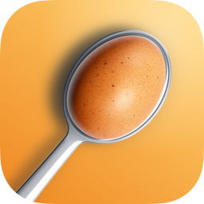
</p>

<h1 align="center">Eggscape</h1>

<p align="center">
  <b>The egg-and-spoon race for iPhone.</b><br>
  Your phone is the spoon. Tilt it to keep the egg in the bowl, against the clock, the weather and your friends.
</p>

<p align="center">
  <a href="https://github.com/juliusedel/eggscape/actions/workflows/ci.yml"></a>
  
  
  
  
  
</p>

<p align="center">
  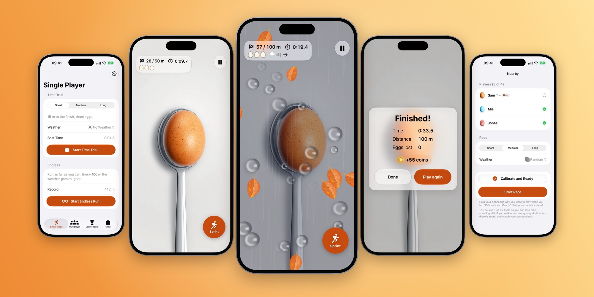
</p>

## About

*Eierlauf*, the egg-and-spoon race, is a classic at German children's parties and summer fêtes: get to the finish
with an egg on a spoon, and don't drop it. Eggscape brings it to the iPhone. A photo-realistic egg lies in a
stainless-steel spoon seen from above, and the phone in your hand is that spoon. The course runs by itself, so you can
also play standing still. Every footstep makes the egg wobble; tilt too far and it rolls over the rim and breaks.

Eggscape is a native Swift app without third-party dependencies and is being prepared for the App Store.

## Screenshots

<table>
  <tr>
    <td align="center">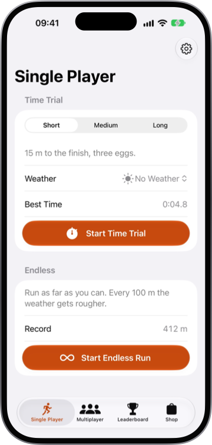<br><sub><b>Pick a race</b></sub></td>
    <td align="center">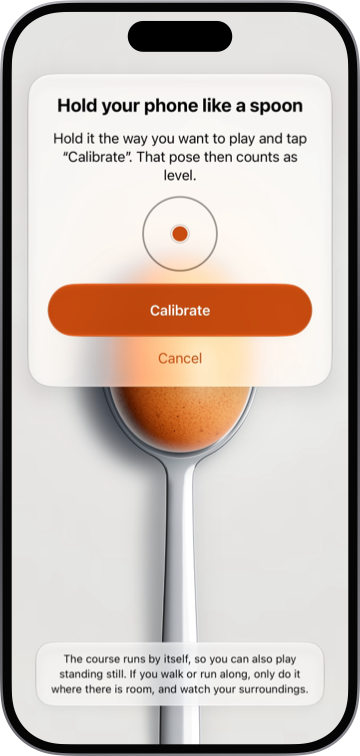<br><sub><b>Calibrate</b></sub></td>
    <td align="center">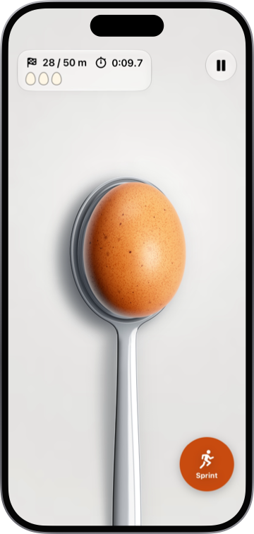<br><sub><b>Keep it in the bowl</b></sub></td>
    <td align="center">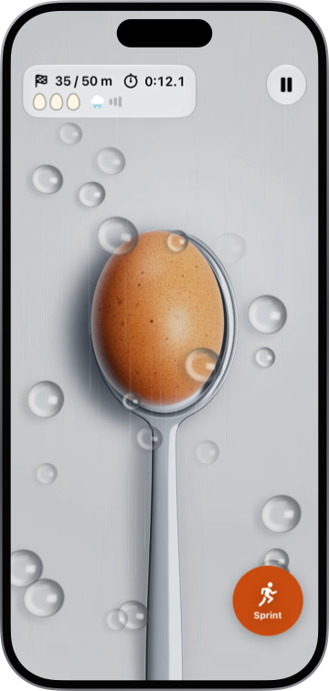<br><sub><b>Rain</b></sub></td>
  </tr>
  <tr>
    <td align="center">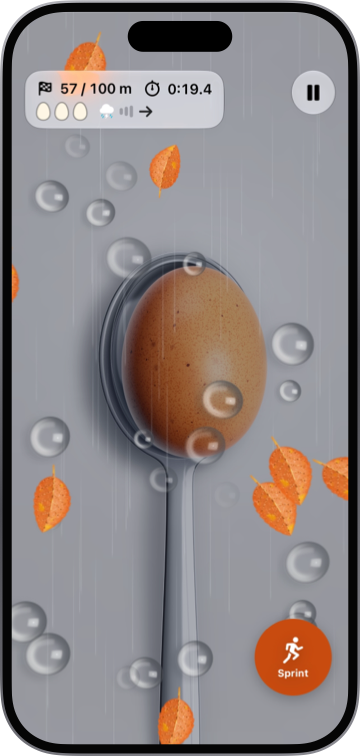<br><sub><b>Thunderstorm</b></sub></td>
    <td align="center">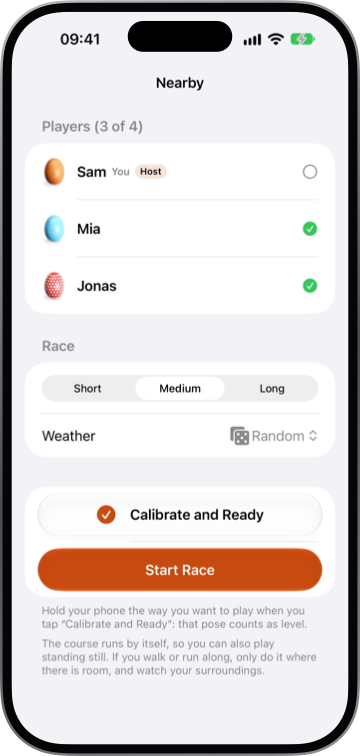<br><sub><b>Race nearby phones</b></sub></td>
    <td align="center">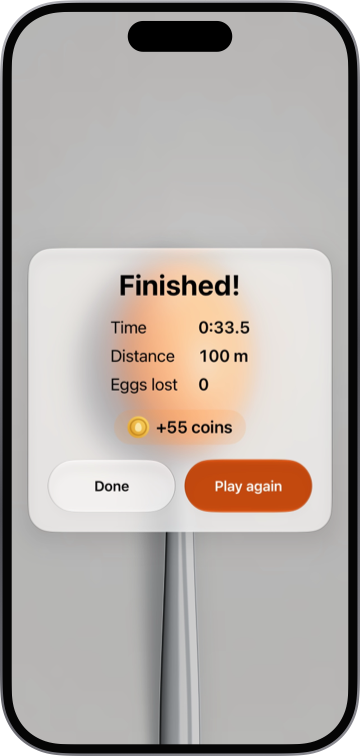<br><sub><b>Finish and earn coins</b></sub></td>
    <td align="center">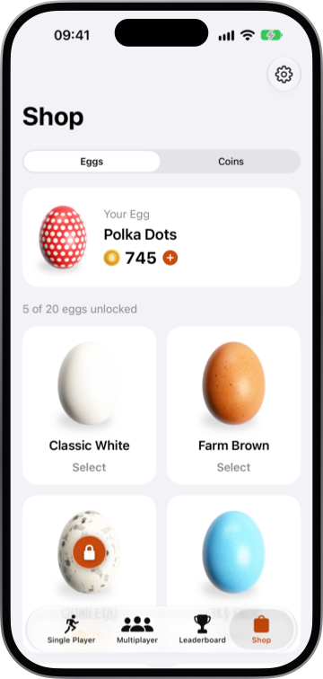<br><sub><b>Collect egg skins</b></sub></td>
  </tr>
</table>

## How to play

1. Hold the phone flat in front of you like a spoon and tap **Calibrate**: that pose counts as level.
2. After "3, 2, 1, Go!" the course runs by itself. Every footstep makes the egg wobble.
3. Keep the egg in the middle with small tilts. The phone buzzes harder the closer the egg gets to the rim.
4. Hold **Sprint** to run faster, at the price of a much shakier egg.
5. Three eggs per run. Wind pushes the egg sideways, rain makes the spoon slippery, a thunderstorm adds lightning.

## Features

- **Five ways to play.** **Time Trial** over 15, 50 or 100 m, **Endless**, **Pass the Phone** for 2–4 players on one
  phone, **Nearby** for 2–4 phones in the same room without internet, and **Online** for 2–4 players through Game
  Center, friends included.
- **Weather.** Race without weather, in wind, rain or a thunderstorm, or let it change at random and get rougher along
  the track. In an endless run the weather gets rougher every 100 m.
- **Two backgrounds.** A white studio surface like a product photo, or the live rear camera, so you look "through" the
  phone at the ground you are running on.
- **20 egg skins.** Dyed, patterned, pearl and metallic eggs, bought with coins you earn by playing. Coin packs are also
  sold as in-app purchases.
- **Leaderboards.** Personal bests and Game Center leaderboards for every distance and for the endless run.
- **Accessible and private.** Dynamic Type, Reduce Motion and Dim Flashing Lights are respected. No ads, no tracking, no
  account, no backend.

## Technical highlights

- **Swift 6 with strict concurrency.** SwiftUI for the menus and overlays, SpriteKit for the game scene, `@Observable`
  view models and UI types on the main actor.
- **A deterministic, tested core.** Physics, run rules, weather, the multiplayer protocol and the shop economy live in
  `EggscapeCore`, a Swift package without UIKit, SpriteKit or SwiftUI. `RunEngine` is a plain value type stepped at a
  fixed 120 Hz that never reads a clock, so every rule (thresholds, weather, finish order) is unit-tested.
- **Fair weather without streaming it.** Every gust and lightning strike of a race derives from its seed (SplitMix64),
  so all phones in a multiplayer race see the same weather.
- **Multiplayer without a backend.** One JSON message format runs over MultipeerConnectivity for nearby rooms and over
  GameKit (`GKMatch`) online. The host referees the race: it syncs the clocks by ping and pong, sets a shared start
  instant and decides the finish order. Messages with numbers no real phone sends are dropped, so a modified client
  cannot crash the others.
- **Procedural art and sound.** No stock assets: the steel spoon, all 20 egg skins, raindrops, leaves and the app icon
  are rendered in code by `EggscapeArt` (pure Swift, Foundation only), and the 13 sound effects are synthesized by a
  script.
- **Sensors and feedback.** CoreMotion at 100 Hz with calibration and a low-pass filter, CoreHaptics for the warning
  near the rim, and the rear camera through AVFoundation.
- **StoreKit 2 and Game Center.** Consumable coin packs are credited exactly once per transaction; Game Center runs the
  leaderboards and the matchmaking for online races.
- **Quality.** 406 unit tests with Swift Testing in the package and the app, UI tests that play a complete race,
  GitHub Actions CI, SwiftFormat, a check that every UI string has an English translation, and App Store screenshots
  captured by a script.

## Architecture

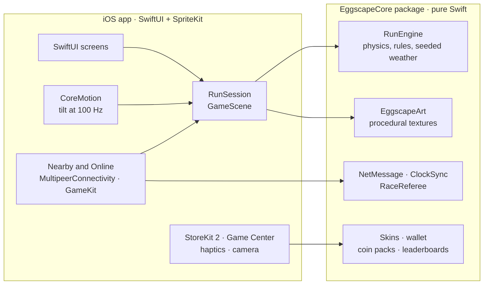

The physics run on a fixed timestep inside `RunEngine`, so they behave the same at 60 fps, at 120 fps and after a
dropped frame. [`docs/ARCHITECTURE.md`](docs/ARCHITECTURE.md) has the contracts between the modules.

<details>
<summary><b>Project structure</b></summary>

```
Packages/EggscapeCore     pure Swift, tested with `swift test`
  EggscapeCore            physics, run engine, weather schedule, seeded RNG,
                          multiplayer messages, shop economy, leaderboard ids
  EggscapeArt             procedural photo-realistic textures (egg skins, spoon, effects)
  eggscape-art            command line tool that writes the spoon assets and preview sheets
App/                      SwiftUI menus + SpriteKit game scene
  Sensors/                CoreMotion tilt (100 Hz, low-pass), calibration, finger fallback
  Game/                   GameScene (120 Hz steps from SKScene.update), RunSession, launcher
  Feedback/               CoreHaptics and synthesized sounds
  Camera/                 rear camera background
  Persistence/            settings, personal bests, wallet (UserDefaults)
  Store/  GameCenter/     StoreKit 2 coin packs, Game Center leaderboards
  Multiplayer/            transport protocol, MultipeerConnectivity, GameKit,
                          lobby and race coordination
  Features/               tabs, settings, tutorial, run overlays
EggscapeTests/            app unit tests (Swift Testing)
EggscapeUITests/          UI tests, including a complete 15 m time trial
scripts/                  screenshots, sounds, README images, string and site checks
docs/                     architecture, tuning, device tests, release guide, assumptions
```

</details>

## Getting started

Eggscape is built with Xcode 27.2 and runs on iPhones with iOS 17 or later.

```bash
brew install xcodegen swiftformat fastlane
make gen   # generates Eggscape.xcodeproj from project.yml (never edit it)
make run   # builds and launches the app on an iPhone simulator
```

Without Homebrew, `make bootstrap` builds XcodeGen and SwiftFormat from source. In the Simulator there are no motion
sensors: drag the egg with a finger instead.

| Command | What it does |
|---|---|
| `make test` | EggscapeCore tests (`swift test`) and the app unit tests on a simulator |
| `make test-ui` | UI tests, including a complete 15 m time trial |
| `make build` | Unsigned simulator build (what CI runs) |
| `make format` / `make lint` | SwiftFormat |
| `make art` | Re-renders the spoon images into the asset catalog |
| `make sounds` | Re-synthesizes the sound effects |
| `make icon` | Re-renders the app icon |
| `make beta` / `make release` / `make screenshots` | fastlane lanes, see `docs/RELEASE.md` |
| `make screenshots-sim` | App Store screenshots with simctl alone, no fastlane or UI tests |
| `make readme-images` | Renders the images of this README from those screenshots |
| `make site-check` | Checks the support and privacy pages in `site/` before they go live |

## Documentation

| Document | What it covers |
|---|---|
| [`ARCHITECTURE.md`](docs/ARCHITECTURE.md) | Modules, conventions and the contracts between them |
| [`TUNING.md`](docs/TUNING.md) | The physics and how to tune them |
| [`TESTING.md`](docs/TESTING.md) | Automated tests and the checklist for real devices |
| [`RELEASE.md`](docs/RELEASE.md) | The way to the App Store, step by step |
| [`ASSUMPTIONS.md`](docs/ASSUMPTIONS.md) | Every decision taken without asking |

## Privacy

No accounts of our own, no backend, no analytics, no ads, no tracking, no third-party SDKs. Game Center is only needed
for online races and leaderboards.
